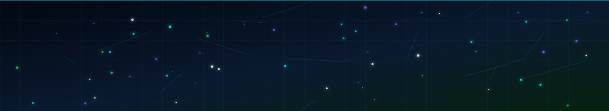
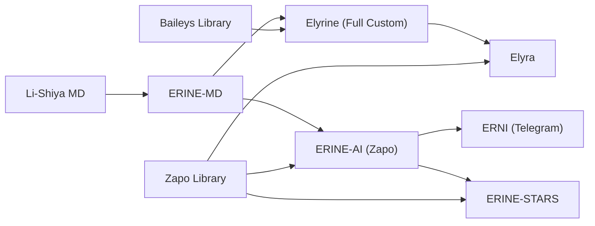
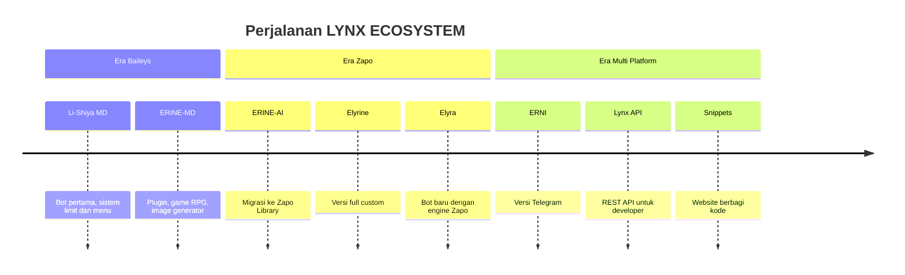
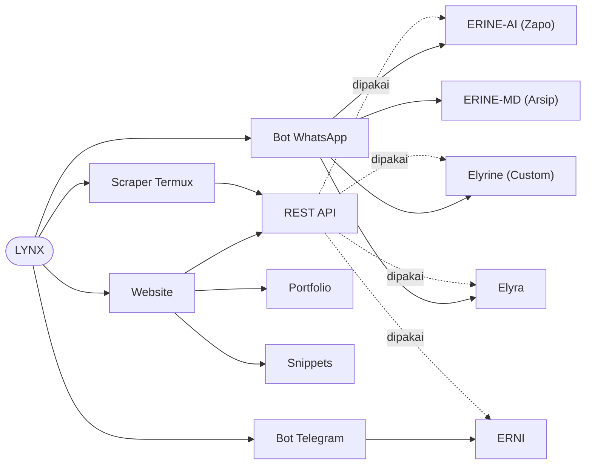
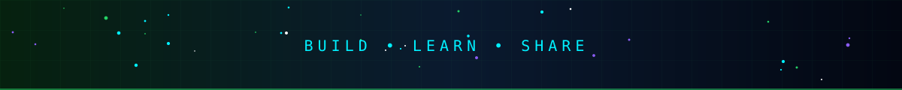

<!-- ================= HEADER ================= -->
<p align="center">
  
</p>

<p align="center">
  
</p>

<p align="center">
  
</p>

<p align="center">
  <a href="https://github.com/Lynxcode-id"></a>
  
  
</p>

<p align="center">
  <a href="https://whatsapp.com/channel/0029VbCUDdOHFxOyVb2Hfe2X"></a>
  <a href="https://chat.whatsapp.com/L4hc1V7IgOsLqA7o5TXEPj?s=cl&p=a&iam=2"></a>
  <a href="https://saweria.co/LynxPreset"></a>
</p>

<p align="center"></p>

<!-- ================= NAVIGASI ================= -->
<h3 align="center">🧭 Navigasi Cepat</h3>

<p align="center">
  <a href="#-tentang-lynx"></a>
  <a href="#-semua-project"></a>
  <a href="#-library--api"></a>
  <a href="#-fitur-unggulan"></a>
  <a href="#-ecosystem-lynx"></a>
  <a href="#-jadibot-clone"></a>
  <a href="#-tech-stack"></a>
  <a href="#-faq"></a>
  <a href="#-kontak--sosmed"></a>
</p>

> 💡 **Tips:** Banyak bagian di bawah berupa kotak **▶ klik untuk buka**. Pencet judulnya untuk membuka/menutup isinya.

<p align="center"></p>

<!-- ================= TENTANG ================= -->
## 👤 Tentang Lynx

> **Automation • WhatsApp Bot • AI Project**
> Terima kasih atas dukungannya! Tempat eksplorasi, share & develop sistem bot.

Halo, saya **Lynx** 👋 — developer yang fokus membangun **bot WhatsApp**, **bot Telegram**, **REST API**, **scraper**, dan **website** untuk komunitas. Semua project saling terhubung dalam satu ecosystem: bot memakai API Lynx, API memakai scraper, dan semuanya didokumentasikan lewat Snippets. Prinsipnya sederhana: **modular, ringan, dan tidak terpecah-pecah**.

<table>
<tr>
<td width="50%" valign="top">

### ⚡ What I Do
- 🤖 WhatsApp Multi-Device Bot
- ✈️ Telegram Bot
- 🧠 AI & Automation
- 🌐 REST API (sistem apikey bertingkat)
- 🛠️ Backend Development
- 📦 Plugin Architecture
- 🗄️ Database (SQLite, Turso/LibSQL)
- 🕷️ Scraper & Downloader
- 🎨 Image Generator (Canvas / Sharp)
- 🌍 Web (Next.js)

</td>
<td width="50%" valign="top">

### 🔭 Currently Working On
- 🧠 ERINE-AI ~ ZAPO Library
- 🎨 Elyrine Full Costum
- 🌠 Elyra (bot berbasis Zapo JS)
- 📚 Elyra-Labs Baileys (library)
- ✈️ ERNI — ERINE-AI Telegram Version
- 🔌 Lynx Apis & Lynx Decode API
- 🧩 Lynx Snippets V2
- 🕷️ Scraper downloader (Termux)

</td>
</tr>
</table>

<details>
<summary><b>🎯 Misi & Prinsip Lynx (klik untuk buka)</b></summary>
<br>

| Prinsip | Penjelasan |
|---|---|
| 🧩 **Modular** | Setiap fitur dibuat sebagai plugin terpisah, satu command satu file, mudah dipasang/dicabut |
| 🔗 **Konsisten** | Satu sistem saling terhubung, struktur folder & gaya kode seragam antar project |
| 🪶 **Ringan** | Hemat RAM & resource, cocok untuk panel/VPS kecil |
| 🛡️ **Stabil** | Anti-spam, anti-crash, session aman saat trafik tinggi |
| 🤝 **Terbuka** | Share ilmu lewat snippet, API, dan komunitas |
| 🎯 **Teliti** | Setiap perubahan dicek dulu supaya tidak merusak bagian lain |

</details>

<details>
<summary><b>📈 Statistik ecosystem sekilas (klik)</b></summary>
<br>

| Kategori | Jumlah | Keterangan |
|---|---|---|
| 🤖 Bot WhatsApp | 5+ | ERINE-AI, Elyrine, Elyra, ERINE-STARS, ERINE-MD, Li-Shiya |
| ✈️ Bot Telegram | 1 | ERNI |
| 📚 Library | 2 | Elyra-Labs Baileys, Elyrine Baileys |
| 🔌 REST API | 2 | Lynx Apis, Lynx Decode API |
| 🌐 Website | 4 | Portfolio, Snippets, Snippets V2, REST API |
| 🕷️ Scraper | 6+ | TikTok, Instagram, YouTube, Threads, JKT48, dll |
| 📢 Channel WA | 3 | Api's, INF Code, L-Store |
| 💬 Grup WA | 3 | Erine (ditutup), Elyrine, Elyra |

</details>

<p align="center"></p>

<!-- ================= SEMUA PROJECT ================= -->
## 📂 Semua Project

### 🟢 Project Lanjutan — baru & terus dikembangkan!

<table>
<tr>
<td width="50%" valign="top">

#### 🧠 ERINE-AI ~ ZAPO LIBRARY
Bot WhatsApp berbasis **Zapo Library**: plugin, AI, downloader, tools, game RPG, dan automation. Project utama yang paling aktif.

<a href="https://github.com/Lynxcode-id/ERINE-AI"></a>

</td>
<td width="50%" valign="top">

#### 🎨 Elyrine Full Costum
Versi **full custom** dengan fitur, menu & tampilan khusus. Menjadi tempat fitur-fitur terbaru dikumpulkan.

<a href="https://github.com/Lynxcode-id/elyrine"></a>

</td>
</tr>
<tr>
<td width="50%" valign="top">

#### 📚 Elyra-Labs Baileys
Library WhatsApp tipe Baileys (`@elyra-labs/baileys`), **ESM-only**, fork dari `@vanzxy/baileys`, dipakai sebagai mesin bot Elyra.

<a href="https://github.com/Lynxcode-id/Elyra-Labs-baileys"></a>

</td>
<td width="50%" valign="top">

#### 🔧 Elyrine Baileys
Library Baileys khusus Elyrine — berisi perbaikan kompatibilitas setelah WhatsApp update (misalnya pembacaan view once).

<a href="https://github.com/Lynxcode-id/elyrine-baileys"></a>

</td>
</tr>
</table>

### 🔴 Project Berhenti — terima kasih atas perjalanannya

<table>
<tr>
<td width="50%" valign="top">

#### 🤖 ERINE-MD
WhatsApp Multi-Device bot dengan plugin, utilitas, downloader, game RPG, image generator, manajemen grup, dan lainnya.

<a href="https://github.com/Lynxcode-id/ERINE-MD"></a>

</td>
<td width="50%" valign="top">

#### 💠 Li-Shiya
Bot WhatsApp Li-Shiya MD, dengan sistem limit harian (reset otomatis 00:00 WITA).

<a href="https://github.com/Lynxcode-id/Li-Shiya-MD"></a>

</td>
</tr>
</table>

<details>
<summary><b>📊 Tabel status semua project (klik)</b></summary>
<br>

| Project | Jenis | Engine / Stack | Status |
|---|---|---|---|
| [ERINE-AI](https://github.com/Lynxcode-id/ERINE-AI) | Bot WhatsApp | Zapo JS | 🟢 Aktif |
| [Elyrine](https://github.com/Lynxcode-id/elyrine) | Bot WhatsApp | Baileys | 🟢 Aktif |
| Elyra | Bot WhatsApp | Zapo JS | 🟢 Aktif |
| ERINE-STARS | Bot WhatsApp | Zapo JS | 🟢 Aktif |
| ERNI (ERINE-AI Telegram) | Bot Telegram | Telegraf | 🟢 Aktif |
| [Elyra-Labs Baileys](https://github.com/Lynxcode-id/Elyra-Labs-baileys) | Library | ESM, Node.js | 🟢 Aktif |
| [Elyrine Baileys](https://github.com/Lynxcode-id/elyrine-baileys) | Library | Node.js | 🟢 Aktif |
| Lynx Apis | REST API | Node.js | 🟢 Aktif |
| Lynx Decode API | REST API | Node.js, Turso, Vercel | 🟢 Aktif |
| Lynx Snippets V2 | Website | Next.js, Turso | 🟢 Aktif |
| Lynx Decode Portfolio | Website | Web | 🟢 Aktif |
| Lynx Decode Scrapers | Tools | Node.js, Termux | 🟢 Aktif |
| [ERINE-MD](https://github.com/Lynxcode-id/ERINE-MD) | Bot WhatsApp | Baileys | 🔴 Berhenti |
| [Li-Shiya MD](https://github.com/Lynxcode-id/Li-Shiya-MD) | Bot WhatsApp | Baileys | 🔴 Berhenti |

</details>

<details>
<summary><b>🧬 Silsilah / evolusi bot (klik)</b></summary>
<br>



</details>

<details>
<summary><b>🗺️ Roadmap & Timeline (klik)</b></summary>
<br>



| Tahap | Target | Status |
|---|---|---|
| 1 | Migrasi plugin ke Zapo Library | 🟢 Berjalan |
| 2 | Elyrine: fitur & tampilan full custom | 🟢 Berjalan |
| 3 | ERNI (Telegram) sinkron dengan ERINE-AI | 🟢 Berjalan |
| 4 | Perluasan Lynx REST API | 🟡 Direncanakan |
| 5 | Dokumentasi plugin untuk komunitas | 🟡 Direncanakan |

</details>

<p align="center"></p>

<!-- ================= LIBRARY & API ================= -->
## 📦 Library & API

### 📚 Library WhatsApp

| Library | Paket | Catatan |
|---|---|---|
| Elyra-Labs Baileys | `@elyra-labs/baileys` | ESM-only, fork `@vanzxy/baileys` |
| Elyrine Baileys | `elyrine-baileys` | Patch kompatibilitas untuk Elyrine |
| Zapo JS | `zapo-js` | Engine ERINE-AI, ERINE-STARS, Elyra |

### 🔌 Lynx REST API

REST API bertingkat dengan sistem **apikey**, mendukung respons **JSON** maupun **gambar**.

| Tier | Kuota |
|---|---|
| 👑 Developer | Unlimited |
| 🏢 Enterprise | 5.000 / bulan |
| 💎 Premium | 2.000 / bulan |
| 🆓 Free | 150 / hari |

<details>
<summary><b>🧾 Format plugin & respons API (klik)</b></summary>
<br>

Setiap endpoint ditulis sebagai plugin ESM dengan struktur seragam:

```js
export default {
  title: 'Nama Endpoint',
  slug: 'nama-endpoint',
  category: 'Downloader',
  method: 'GET',
  path: '/api/downloader/nama-endpoint',
  description: 'Deskripsi singkat endpoint',
  parameters: [{ name: 'url', required: true }],
  async run(req) {
    return { status: true, code: 200, creator: 'Lynx Apis', data: {} }
  }
}
```

Format respons standar:

```json
{
  "status": true,
  "code": 200,
  "creator": "Lynx Apis",
  "data": {}
}
```

</details>

### 🕷️ Lynx Decode Scrapers (Termux)

Kumpulan scraper Node.js yang jalan langsung di Termux, dengan logger rapi, input lewat readline, dan output gaya Lynx API.

| Scraper | Fungsi |
|---|---|
| TikDown | Downloader TikTok |
| SSSTik | Downloader TikTok tanpa watermark |
| FastDL | Downloader Instagram |
| DownloadMedia | Downloader Instagram (alternatif) |
| YTMP3s | YouTube ke MP3/MP4 |
| SnapThreads | Downloader video Threads |
| JKT48 Tracker | Cek status live member JKT48 |

<p align="center"></p>

<!-- ================= FITUR ================= -->
## ✨ Fitur Unggulan

> Pencet tiap kategori untuk lihat isinya 👇

<details>
<summary><b>📥 Downloader</b></summary>
<br>

- 🎵 **TikTok** — video, foto slide, dan audio
- ▶️ **YouTube** — MP3/MP4, termasuk kirim langsung ke saluran (channel)
- 📸 **Instagram** — post, reel, dan album
- 🌐 **AIO Downloader** — satu command untuk banyak platform (foto album, video + caption, audio)
- 🧵 **Threads** — download video
- 🤖 **Auto download** TikTok per grup (on/off)

</details>

<details>
<summary><b>🛠️ Tools & Utility</b></summary>
<br>

- 🖼️ **HD / Upscale** gambar (2x & 4x)
- 👁️ **Baca View Once** (RVO)
- 🎶 **Lirik lagu** — pencarian cepat
- 🔗 **Link preview custom** — thumbnail & favicon bisa diatur per bot
- 🎙️ **Play** musik YouTube dan **Play Channel** ke saluran WhatsApp
- 📢 **Broadcast & JPM** — kirim pesan massal ke grup/chat
- 📇 **Push Kontak** — simpan nomor & kirim ke member grup
- 🌍 **Info Gempa otomatis** dan status bot (`pingall`)
- 🎭 **Sticker** TikTok

</details>

<details>
<summary><b>🎨 Image Generator (Canvas)</b></summary>
<br>

- 📱 Notifikasi iPhone (WhatsApp & TikTok)
- 💬 Quote chat gaya iPhone (IQC) dengan emoji Apple
- 📝 Catatan Instagram & kartu kutipan IG
- 📞 Fake call Discord
- 📸 Polaroid, grid foto iOS, menu iMessage
- ✈️ Post channel Telegram
- 🟩 Greenscreen — foto masuk ke template
- 🧾 Profil RPG berbentuk kartu gambar

</details>

<details>
<summary><b>🎮 Game & RPG</b></summary>
<br>

- 🐺 **Werewolf** — lobi, peran, fase malam/siang, taruhan, toko, statistik
- 🧙 **Profil RPG** — level, EXP, keuangan, asmara & keluarga
- 🏆 **Leaderboard** total pesan harian / bulanan / semua
- 💰 Database RPG terpisah agar bot utama tetap ringan

</details>

<details>
<summary><b>👑 Group, Owner & Premium</b></summary>
<br>

- 🛡️ Antispam command (batas hit, tenggang, ban otomatis)
- 🔒 Tutup grup otomatis saat terlalu ramai
- ⏱️ Sistem limit user dengan reset otomatis tiap 00:00 WITA
- 💎 Paket **Premium** & **Sewa Grup** (pricelist lewat command)
- ☁️ Kelola **VPS** & server langsung dari bot
- 🔐 Penyimpanan session aman saat trafik tinggi

</details>

<details>
<summary><b>🔊 Voice & Menu Interaktif</b></summary>
<br>

- 🎙️ Menu dengan **voice note** otomatis
- 🎧 Rich music player **LYNX AUDIO**
- 📋 Menu auto-scan plugin (WhatsApp & Telegram)
- 🖼️ Menu dengan link preview bergambar

</details>

<details>
<summary><b>✈️ ERNI — Bot Telegram</b></summary>
<br>

- 📋 Menu otomatis hasil scan plugin, command `/menu all`
- 💾 Simpan plugin langsung dari chat (`/sp`)
- 🎙️ Voice menu
- 🔗 Sinkron dengan fitur ERINE-AI

</details>

<p align="center"></p>

<!-- ================= ECOSYSTEM ================= -->
## 📡 Ecosystem Lynx

### 🌐 Website

<table>
<tr>
<th>Resource</th>
<th>Deskripsi</th>
<th>Link</th>
</tr>
<tr>
<td>👨‍💻 Portfolio</td>
<td>Profil & karya Lynx</td>
<td><a href="https://www.lynxdev.my.id/">lynxdev.my.id</a></td>
</tr>
<tr>
<td>🧩 Snippets</td>
<td>Kumpulan snippet kode</td>
<td><a href="https://lynxsnippets.web.id">lynxsnippets.web.id</a></td>
</tr>
<tr>
<td>🧩 Snippets V2</td>
<td>Snippet Labs versi 2 (login Google, API key bertingkat)</td>
<td><a href="https://lynxsnippets2.web.id">lynxsnippets2.web.id</a></td>
</tr>
<tr>
<td>🔌 Rest API</td>
<td>REST API untuk bot & developer</td>
<td><a href="https://lynxapis.my.id">lynxapis.my.id</a></td>
</tr>
</table>

### 📢 Channel & Grup WhatsApp

<table>
<tr>
<th>Nama</th>
<th>Tipe</th>
<th>Link</th>
</tr>
<tr>
<td>🔗 Api's</td>
<td>Channel</td>
<td><a href="https://whatsapp.com/channel/0029VbCMzVqE50UZAnV44u05">Join Channel</a></td>
</tr>
<tr>
<td>💻 INF Code</td>
<td>Channel</td>
<td><a href="https://whatsapp.com/channel/0029VbCUDdOHFxOyVb2Hfe2X">Join Channel</a></td>
</tr>
<tr>
<td>🛒 L-Store</td>
<td>Channel</td>
<td><a href="https://whatsapp.com/channel/0029Vb6eyvOJUM2caRIktb2L">Join Channel</a></td>
</tr>
<tr>
<td>💬 GC Erine</td>
<td>Grup (⛔ ditutup)</td>
<td><a href="https://chat.whatsapp.com/LkGni5cerM91DpZ0UJ8cut">Link</a></td>
</tr>
<tr>
<td>💬 GC Elyrine</td>
<td>Grup</td>
<td><a href="https://chat.whatsapp.com/Fk2geM46pu87FFE533a7uS">Join Grup</a></td>
</tr>
<tr>
<td>💬 GC Elyra</td>
<td>Grup</td>
<td><a href="https://chat.whatsapp.com/L4hc1V7IgOsLqA7o5TXEPj?s=cl&p=a&iam=2">Join Grup</a></td>
</tr>
</table>

> 🏷️ **Perhatian !!**
> Group chat **Erine AI** saat ini **ditutup** dan tidak menerima request masuk. Yang terbuka saat ini hanya grup **Li Shiya MD** dan **Elyra** saja.

<details>
<summary><b>🗺️ Peta hubungan ecosystem (klik)</b></summary>
<br>



</details>

<p align="center"></p>

<!-- ================= JADIBOT ================= -->
## 🪄 JADIBOT CLONE

**100% Free!** Jadikan nomor kamu sebagai bot sendiri.

<details open>
<summary><b>📖 Cara pakai (klik untuk tutup/buka)</b></summary>
<br>

1. 🔗 Join grup community
2. ⌨️ Ketik `.jadibot`
3. 📲 Ikuti instruksi dari bot
4. ✅ Bot kamu aktif

</details>

> ⚠️ **Note:** Gunakan dengan segala risiko tanggungan diri sendiri.

<p align="center"></p>

<!-- ================= TECH ================= -->
## 🧰 Tech Stack

<p align="center">
  
</p>

<p align="center">
  
  
  
  
  
  
  
  
</p>

<details>
<summary><b>🧱 Arsitektur bot (klik)</b></summary>
<br>

```text
 Pesan masuk
     │
     ▼
 ┌─────────────┐   ┌────────────────┐   ┌──────────────┐
 │  Handler    │──▶│ Antispam/Limit │──▶│ Plugin Loader│
 └─────────────┘   └────────────────┘   └──────┬───────┘
                                               │
        ┌───────────────┬──────────────┬───────┴──────┐
        ▼               ▼              ▼              ▼
   Downloader        Tools         Game/RPG      Image Canvas
        │               │              │              │
        └───────────────┴─── lib/ + Database ─────────┘
```

</details>

<details>
<summary><b>📁 Struktur folder umum bot (klik)</b></summary>
<br>

```text
bot/
├── plugins/        # satu command satu file
│   ├── downloader/
│   ├── tool/
│   ├── image/
│   ├── rpg/
│   └── owner/
├── lib/            # helper bersama (db, canvas, album, dll)
├── scrape/         # scraper internal
├── config.js       # pengaturan bot
└── index.js        # entry point
```

</details>

<p align="center"></p>

<!-- ================= SNAKE & STATS ================= -->
## 🐍 Contribution Snake

<p align="center">
  
</p>

## 📊 GitHub Stats

<p align="center">
  
</p>

<p align="center">
  
  
</p>

<div align="center">
<table>
<tr><th>Repo</th><th>⭐ Stars / Forks</th><th>🕒 Last Commit</th><th>💻 Bahasa</th><th>📦 Size</th></tr>
<tr><td><a href="https://github.com/Lynxcode-id/ERINE-AI"><b>ERINE-AI</b></a></td><td> </td><td></td><td></td><td></td></tr>
<tr><td><a href="https://github.com/Lynxcode-id/elyrine"><b>Elyrine</b></a></td><td> </td><td></td><td></td><td></td></tr>
<tr><td><a href="https://github.com/Lynxcode-id/Elyra-Labs-baileys"><b>Elyra-Labs Baileys</b></a></td><td> </td><td></td><td></td><td></td></tr>
<tr><td><a href="https://github.com/Lynxcode-id/elyrine-baileys"><b>Elyrine Baileys</b></a></td><td> </td><td></td><td></td><td></td></tr>
<tr><td><a href="https://github.com/Lynxcode-id/ERINE-MD"><b>ERINE-MD</b></a></td><td> </td><td></td><td></td><td></td></tr>
<tr><td><a href="https://github.com/Lynxcode-id/Li-Shiya-MD"><b>Li-Shiya-MD</b></a></td><td> </td><td></td><td></td><td></td></tr>
</table>
</div>

## 📈 Contribution Activity

<p align="center">
  <a href="https://github.com/Lynxcode-id"></a>
</p>

<p align="center"></p>

<!-- ================= FAQ ================= -->
## ❓ FAQ

<details>
<summary><b>Bot ini gratis?</b></summary>
<br>
Jadibot clone <b>100% gratis</b>. Fitur Premium & Sewa Grup tersedia untuk akses lebih lengkap. Hubungi admin untuk info harga.
</details>

<details>
<summary><b>Beda ERINE-AI, Elyrine, Elyra, dan ERINE-MD?</b></summary>
<br>

| Bot | Engine | Ciri |
|---|---|---|
| ERINE-AI | Zapo JS | Versi utama yang aktif, plugin lengkap |
| Elyrine | Baileys | Versi full custom, menu & tampilan khusus |
| Elyra | Zapo JS | Bot baru dengan plugin downloader & tools |
| ERINE-MD | Baileys | Versi lama, sudah berhenti |

</details>

<details>
<summary><b>Apa itu Baileys dan Zapo JS?</b></summary>
<br>
Keduanya adalah library untuk menghubungkan Node.js ke WhatsApp Multi-Device. Baileys lebih dulu populer, sedangkan Zapo JS dipakai pada project-project terbaru Lynx.
</details>

<details>
<summary><b>Boleh pakai script / snippet Lynx?</b></summary>
<br>
Boleh untuk belajar. Cek <a href="https://lynxsnippets.web.id">Snippets</a> dan <a href="https://lynxapis.my.id">REST API</a>. Mohon sertakan kredit dan jangan diperjualbelikan ulang tanpa izin.
</details>

<details>
<summary><b>Ada bug / mau request fitur?</b></summary>
<br>
Buka <b>Issues</b> di repo terkait, atau chat Support (lihat bagian Kontak). Sertakan log error dan langkah mengulang.
</details>

<details>
<summary><b>Kenapa admin lama balas?</b></summary>
<br>
Admin tidak online 24 jam. Mohon sabar dan jangan spam chat/telepon.
</details>

<p align="center"></p>

<!-- ================= KONTAK ================= -->
## 🌐 Kontak & Sosmed

<table>
<tr>
<td>💼 <b>Bisnis</b></td>
<td><a href="https://wa.me/6285143688664"></a></td>
</tr>
<tr>
<td>🛟 <b>Support</b></td>
<td><a href="https://wa.me/6281362133135"></a></td>
</tr>
<tr>
<td>🤖 <b>Bot Tele</b></td>
<td>
<a href="https://t.me/Lynxcpanel_bot"></a>
<a href="https://t.me/Lynxmanuelz4"></a>
</td>
</tr>
<tr>
<td>📱 <b>Sosmed</b></td>
<td>
<a href="https://instagram.com/lynxdecode_"></a>
<a href="https://youtube.com/@lynxdecode_"></a>
<a href="https://tiktok.com/@olineonlyy_"></a>
</td>
</tr>
</table>

## ☕ Support Us

<p align="center">
  <a href="https://saweria.co/LynxPreset"></a>
  <a href="https://ngl.link/lynxdsinii"></a>
</p>

<p align="center"></p>

## ⚠️ Notes

- ⏳ Admin mungkin **slow respon**
- 🚫 Dilarang **spam chat/telepon** (Auto-Block)
- 🤝 **Budayakan salam**
- 🔐 Jangan bagikan session/creds bot ke siapa pun

<br>

<p align="center">
  
</p>

<p align="center">
  
</p>

<p align="center">
  
</p>

<p align="center"><sub>© Lynx Decode • Developer & Builder</sub></p>
